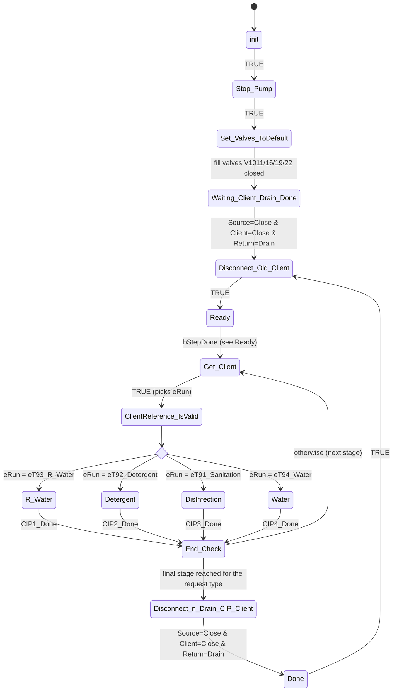
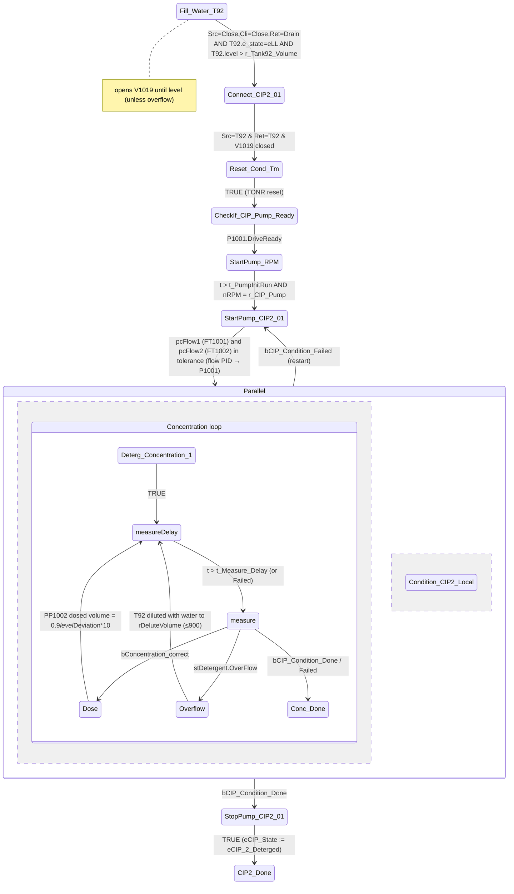
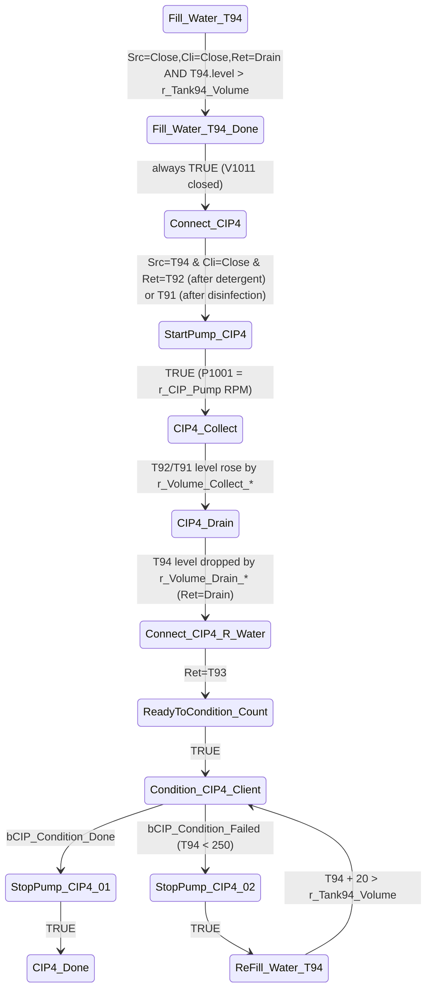

# CIP: state machine and inputs of the current wash logic

Source: `GAD001_PLC/PLC/03 Project/23 CIP/` (branch `feature/anybus-interface`, base commit `13250a7`).
The SFC graphs were extracted from the XML of the `act_Oper` actions; step actions and conditions come from the ST code.

---

## 1. Architecture

```
MAIN.act_Call_CIP
 └─ g_Data.fbCIP : FB_CIP              ← main SFC (wash sequence)
      ├─ fbCIP_Source : FB_CIP_Source  ← SFC: which tank feeds the line (T91/T92/T93/T94/Close)
      ├─ fbCIP_Return : FB_CIP_Return  ← SFC: where the return goes (T91/T92/T93/T94/Drain)
      ├─ fbCIP_Usage  : FB_CIP_Client  ← SFC: client selection (Close/Marinade/Color/Drain/Loop/Future)
      ├─ fb_PumpCIP   = P1001 (VFD, RPM)
      ├─ fb_PumpDetergent  = fbDosingPP1002
      ├─ fb_PumpDisinfection = fbDosingPP1003
      └─ fb_HeatExchenger
```

Tanks: **T91** = disinfection (Sanitation), **T92** = detergent, **T93** = recovered water (R_Water), **T94** = clean water.
Fill valves: T91 = V1022, T92 = V1019, T93 = V1016, T94 = V1011.

All three sub-FBs work on a "request → status by valve feedback" pattern: `m_Run(eReqProc)` sets the request and `m_CheckStatus(eReqStatus)` returns TRUE once the valves have physically (per `fbPis.m_CheckByRecipe`) reached the matching combination and the sub-FB is back in `Ready`.

---

## 2. Top level: FB_CIP.act_Oper



### 2.1 `Ready`: start conditions
| `eMode` | Leaves `Ready` when |
|---|---|
| `eOff` | never (`bRun := FALSE`). Edge into Off → `SFCReset` |
| `eManual` | `bRun` (HMI Start) **AND** `arCIP_RequestBufer[0].eClient <> eNotInUse` |
| `eAuto` | queue not empty → sets `bRun := TRUE` itself |

`_aReady_exit`: `eReq := arCIP_RequestBufer[0]`; for `Full` → `eCIP_State := eNotClean`, otherwise → `eCIP_1_Rinzed`; `g_Data.b_CIP_Run := TRUE`.
`_ainit_exit`: **Auto is forced to Manual** after every reset.

### 2.2 `Get_Client`: stage selection (`eRun`) from `eReq.eType` × `eCIP_State`

| `eCIP_State` → | eNotClean | eCIP_1_Rinzed | eCIP_2_Deterged | eCIP_3_Deterged_Clean | eCIP_4_Sanitized |
|---|---|---|---|---|---|
| **R_Water** | T93 R_Water | – | – | – | – |
| **Detergent** | T93 R_Water | T92 Detergent | T94 Water | (end) | – |
| **Full** | T93 R_Water | T92 Detergent | T94 Water | T91 Sanitation | T94 Water → (end) |

`End_Check`: done when `Detergent` + `eCIP_3_Deterged_Clean`, or `Full` + `eCIP_5_Done`.

So **Full** = R_Water → Detergent → Water → DisInfection → Water.
`eCIP_State` only moves forward (`m_Set_CIP_State`).

> Note: `Detergent` starts directly from `eCIP_1_Rinzed`, so it **skips** the pre-rinse. `Full` starts from `eNotClean`.
> `m_TakePosInCIPBuffer` accepts only `eClient = eLocal` and type `Detergent|Full`; `R_Water` cannot be queued.

---

## 3. Macros (stages)

### 3.1 R_Water (CIP1, pre-rinse): **stub**
```
Client_Check_01 --TRUE--> CIP1_Done (entry: eCIP_State := eCIP_1_Rinzed)
```
No valves, no pump, no time, no volume. The stage is only marked as done.

### 3.2 Detergent (CIP2, T92): DisInfection (CIP3, T91) is analogous



**Condition_CIP2_Local** (parallel step):
- P1001 runs on the flow PID, SP = `r_Flow_Pipe`;
- `bCIP_Condition_Failed := TRUE` if FT1001 **or** FT1002 is out of tolerance (latching; reset only in `StartPump_*_entry`);
- the TONR `t_ConditionDetergent` counts **only while all of these hold**: HX TT1105, TT1003 (detergent temp.), TT1101 (return temp.) ≈ `r_Temper_Detergent`; CT1101_3 ≈ `r_DetergentConcentration`; and the concentration loop is in the `measure` step;
- the TONR keeps elapsed time (it is a retentive timer), so any deviation **pauses** the condition count instead of resetting it.

DisInfection differs as follows: T91/V1022, TT1004, CT1101_4, PP1003, `r_Temper_DisInfection`, `t_ConditionDisInfection`, `r_DisInfectionConcentration`. There is no separate `Reset_Cond_Tm` or `CheckIf_CIP_Pump_Ready` step (the reset happens in `Connect_CIP3_01_entry`); the pump only runs for `t_PumpInitRun`, without an RPM check.

### 3.3 Water (CIP4, T94): rinse after chemistry, push-out and chemical recovery



**Condition_CIP4_Client**: after `t_PumpInitRun`, P1001 runs on the flow PID; the return switches T93 ↔ drain by hard-coded T93 levels (<450 → T93, >500 → drain); TONR `t_ConditionWater` counts while FT1001 is in tolerance. There are no temperature or conductivity criteria for rinse-water purity.
`CIP4_Done`: `eCIP_2_Deterged → eCIP_3_Deterged_Clean`, `eCIP_4_Sanitized → eCIP_5_Done`.

---

## 4. Sub-FBs (valve SFCs)

All three have the same shape: `Init → Valves_to_Default → Ready → [branch by eProcess] → Done → Init`.

| FB | Branches | Valve inputs |
|---|---|---|
| FB_CIP_Source | Close / T91 Sanitation / T92 Detergent / T93 R_Water / T94 Water | valTank_Water, valTank_R_Water, valTank_Detergent, valTank_DisInfection, valDrain |
| FB_CIP_Return | Drain / T91 / T92 / T93 / T94 (two valves per tank, `_1`) | valTank_* + valTank_*_1, valDrain |
| FB_CIP_Client | Close / Marinade_Up / Marinade_Low / Color_Up / Color_Low / Drain / Loop / Future | valClient_Source, valClient_Return, valS_*, valDrain, valLoop (V1030), valS_Future |

In Source, the T91/T92/T93 branches first open the tank valve (5–7 s), then the drain valve; the status is taken from the actual valve combination (`act_Status`). `FB_CIP_Client.m_Run(E_CIP_Usage)` maps clients: Tank_1/2 → Marinade_Up, Tank_3/4 → Color_Up, TriBlender/Line Marinade → Marinade_Low, Color → Color_Low, eLocal → Close. **FB_CIP only ever calls it with `eLocal`.**

---

## 5. Inputs the wash logic currently takes

### 5.1 Commands / HMI
| Signal | Effect |
|---|---|
| `fbCIP.eMode` (Off/Manual/Auto) | operating mode; edge into Off → SFC reset |
| `fbCIP.bRun` | Start in Manual |
| `fbCIP.rtReqLocalCIP_Full_HMI.CLK` | queue a request `eLocal / Full` |
| `fbCIP.rtReqLocalCIP_Detergent_HMI.CLK` | queue a request `eLocal / Detergent` |
| `iPosSelect_HMI`, `rtPosMoveHMI_Up/Down`, `rtPosDeleteHMI`, `rtPosDeleteAllHMI`, `rtReqCleanEmpty_HMI` | queue `arCIP_RequestBufer[0..9]` management |
| `bLoadDefSetPoints` | load default tolerances (`mLoadDefProcessSetPoints`) |
| `g_Data.stHeatExchanger.bManual` | manual heat-exchanger mode |
| `stOper[E_ModeZone.eCIP].iActOperation = ePauseAll` | pause the flow PID only (`stFlow1_Rate.bPause`) |
| SFC: `bResume`, `SFCQuitError`, `bResetCycle` (FB_SFC_Cycle) | resume after error, reset |

### 5.2 Recipe parameters `g_Data.arr_CIP_Param[eLocal]` (ST_CIP_Param)
**Used:** `r_Tank91/92/94_Volume`, `r_CIP_Pump`, `r_Flow_Pipe`, `r_DetergentConcentration`, `r_DisInfectionConcentration`, `t_Measure_Delay`, `t_ConditionDetergent`, `t_ConditionDisInfection`, `t_ConditionWater`, `r_Temper_Detergent`, `r_Temper_DisInfection`, `t_PumpInitRun`, `r_Volume_Collect_Detergent/DisInfection`, `r_Volume_Drain_Detergent/DisInfection`.
**Not used** (declared only): `r_Tank93_Volume`, `r_CIP_Client_Pump`, `r_Flow_Sprinkler`, `t_ConditionR_Water`, `t_Condition*_Sprinkler`, `r_Volume_Sprinkler_Ratio`, `r_Volume_Solution_Fill`, `r_Volume_Drain_R_Water`, `r_Volume_Recycle_*`. `r_Pressure` takes no part in any condition (the pressure check is commented out).
Tolerances come from `ST_ProcessControl` (`g_ProcControl`, ProcessControl recipe).

### 5.3 Process sensors
| Tag | Role |
|---|---|
| FT1001 | supply flow: PID → P1001, Failed criterion, condition time |
| FT1002 | return flow: Failed criterion (in Water it is commented out) |
| PT1001 | read, **not used** in conditions |
| TT1105 | heat exchanger outlet temperature (PID + condition) |
| TT1003 / TT1004 | detergent / disinfectant temperature |
| TT1101 | client return temperature |
| CT1101_3 / CT1101_4 | detergent / disinfectant concentration |
| T91..T94 `rTankLevel`, `e_state` (eLL), overflow | fill, volume counting (Collect/Drain), T93 ↔ drain, T94 < 250 failure |

### 5.4 Equipment feedback
- valve positions (`fbPis.m_CheckByRecipe`) of all Source/Return/Client valves and V1011/16/19/22;
- P1001: `DriveReady`, `nRPM`, `modeAuto`;
- PP1002/PP1003: `m_RunVolume` done.

### 5.5 Interlocks
`bStateSafe` and `MAIN.bTemp_Water_Overweight_check` (only in `mFillWater`, T94 top-up; the overweight check is effectively off because of `AND FALSE` in MAIN); tank overflow closes the fill valve in MAIN.

> The Anybus interface (`g_Anybus.fbAnybus`, this branch) is called in MAIN but is **not yet connected** to FB_CIP: requests and modes still come only from the HMI.

---

## 6. Things to verify (independent of the theory)
1. **CIP1 pre-rinse is not implemented** (stub). `Detergent` skips it entirely.
2. **Only the local CIP works** (`eLocal`): client/sprinkler stages (dashboard e01, e02, e05–e07, e11, e14–e16, e20) are marked NotAvailable; FB_CIP_Client is never called with a real client.
3. The transition into dosing is `bConcentration_correct` (= `Control_ON AND NOT OverFlow` for 30 s). The name suggests "concentration OK", but it actually triggers dosing. Check the semantics of `Control_ON` in FB_ProcessControl.
4. Hard-coded values: T94 < 250 (Failed), T93 450/500, dilution ≤ 900 L, concentration filter 30 s, flow PID 700–1700 RPM, release threshold 50 L/h.
5. `Fill_Water_T94_Done` and `StartPump_CIP4` always return TRUE (the checks are commented out).
6. After the chemical condition stage the pump stops, but the tank (T92/T91) is not drained. The chemical is returned to its tank (recovery), and the push-out to the tank is done by water from T94 by volume.
7. There is no pressure criterion and no final-rinse purity criterion (conductivity).
8. Auto → Manual on every `init`.

---

## 6a. What happens on a "Client Pipe" wash request

**Short answer: it is not executed. Today such a request cannot even reach the queue.**

1. **Request sources.** The HMI has only two request buttons: `rtReqLocalCIP_Full_HMI` and `rtReqLocalCIP_Detergent_HMI`. Both hard-code `eClient := eLocal`. The queue table (`vis_CIP_ReqBuffer`) only shows `eType`/`eClient` and offers Up/Down/Delete/Clean; there is no input for choosing a client. Anybus (`FB_Anybus_Interface`) decodes CLIENT ID / CLIENT TYPE from Siemens but is not connected to FB_CIP.
2. **Queue filter.** `m_TakePosInCIPBuffer` accepts only `eClient = eLocal` and type `Detergent|Full`. A request for `eLine_Marinada`, `eLine_Color`, `eTank_1..4` or `eTriBlender_*` is **silently dropped**: no message, no alarm, no feedback.
3. **If the request reached `arCIP_RequestBufer[0]` anyway** (online write, or later via Anybus without changing FB_CIP):
   - `Ready` starts the cycle (it only checks `eClient <> eNotInUse`);
   - `Get_Client` **ignores `eClient`**: `eRun` depends only on `eType` and `eCIP_State`;
   - every stage calls `fbCIP_Usage.m_Run(eLocal)`, so the client valves are held in **Close**, and the local loop (tank → CIP skid → tank) is washed instead of the pipe;
   - the dashboard marks the client stages NotAvailable; `Done` clears the request.
   → **The client is reported as washed but was never washed.** Dangerous for food safety: the request filter is currently the only safeguard.
   - `eCIP_State` is a single variable inside FB_CIP, not per client, so there is no record of "which client is clean".
4. **What exists for a pipe client but is unused:** the `FB_CIP_Client` routes (Marinade_Low / Color_Low for Line and TriBlender; Marinade_Up / Color_Up for tanks), the `eLine_*`/`eTriBlender_*` → selector mapping in `m_Run`/`m_CheckStatus`, the parameters `r_Volume_Solution_Fill`, `r_CIP_Client_Pump`, and the dashboard stages e01, e05, e06, e14, e15. The theory's stages 1, 5, 6, 14, 15 (Drain Product Rest, Client Fill by `r_Volume_Solution_Fill`, Client Condition) have no SFC steps.

---

## 7. Comparison with the theory (Google Sheet "ReMeat03 CIP v0.1")

Sources: the **CIP Parameters** tab (20 stages × parameters) and the **CIP Dashboard** tab. The **PLC Data** tab duplicates the enums (E_CIP_Source/Return/Usage/Mode/Type, E_Element_State_Long) and matches the code.

### 7.1 Overall structure: matches
- The theory is 5 macro stages: **CIP1 R Water → CIP2 Detergent → CIP3 Water → CIP4 DisInfection → CIP5 Water**. The code's `Full` sequence is the same (R_Water → Detergent → Water → DisInfection → Water).
- The theory's 20 stages map **one to one** onto `E_CIP_DashStage_List` e01…e20 (same order, same names). The dashboard enum was clearly derived from this sheet.
- Every stage has 3 variants: **Local**, **Client Pipe**, **Client Sprinkler** ("Only for Tanks"). Each stage row also has the boxes Drain / DisInfection / Detergent / Recycle Water / Water. The sheet does **not mark** which of them is source and which is return: the boxes look the same in every row. The routing is taken from the code only.
- Naming mismatch: in the code's SFC step names, disinfection is called **CIP3** (`Connect_CIP3_01`, `StopPump_CIP3_01`) and the water rinse **CIP4** (`Connect_CIP4`, `CIP4_Collect`). In the theory and in the dashboard, CIP3 = Water and CIP4 = DisInfection.

### 7.2 Stage by stage

| # | Theory: stage | Variant | Theory: parameters | Code | Match |
|---|---|---|---|---|---|
| 1 | CIP1 Drain Product Rest | Client Pipe | Flow pipe, Flow sprinkler, Time | stub `Client_Check_01 → CIP1_Done`; NotAvailable on the dashboard | ❌ not implemented |
| 2 | CIP1 Drain Product Rest | Client Sprinkler | Flow pipe, Flow sprinkler, Time sprinkler | – | ❌ |
| 3 | CIP2 Detergent Fill | Local | *(no parameters in the sheet)* | `Fill_Water_T92` up to `r_Tank92_Volume` + eLL | ✅ implemented; the theory doesn't describe it |
| 4 | CIP2 Detergent Condition | Local | *(no parameters in the sheet)* | full loop: flow PID, temp. TT1105/TT1003/TT1101, concentration CT1101_3 + dosing/dilution, TONR `t_ConditionDetergent` | ✅ implemented; the theory doesn't describe it |
| 5 | CIP2 Detergent Fill | Client Pipe | Flow N.C., Volume min = `r_Volume_Solution_Fill` | parameter exists in ST_CIP_Param but is **unused** | ❌ |
| 6 | CIP2 Detergent Condition | Client Pipe | Flow pipe, Flow sprinkler, Conc., Temp., Time, Time sprinkler | only for Local (step 4); `r_Flow_Sprinkler`, `t_ConditionDetergent_Sprinkler` unused | ❌ for client |
| 7 | (Detergent Condition) | Client Sprinkler | – | – | ❌ |
| 8 | CIP3 Detergent Collect | Client Pipe | Flow pipe, Volume min = `r_Volume_Detergent_Collect` | `CIP4_Collect`: Ret→T92 until ΔT92 ≥ `r_Volume_Collect_Detergent`. **Pump on fixed RPM** (`r_CIP_Pump`), not on flow; only Local | ⚠️ partial |
| 9 | CIP3 Detergent Drain | Client Pipe | Flow pipe, Volume min = `r_Volume_Detergent_Drain` | `CIP4_Drain`: Ret→Drain until −ΔT94 ≥ `r_Volume_Drain_Detergent`; fixed RPM | ⚠️ partial |
| 10 | CIP3 Detergent removing by clean water | Client Pipe | Flow pipe "–", **Flow sprinkler V**, **Time sprinkler V** | `Condition_CIP4_Client`: flow PID on `r_Flow_Pipe`, `t_ConditionWater`, Ret T93↔Drain | ⚠️ the code uses pipe parameters; the theory marks sprinkler ones (probably a column shift in the sheet) |
| 11 | (Detergent Clean) | Client Sprinkler | – | NotAvailable | ❌ |
| 12 | CIP4 DisInfection Fill | Local | *(no parameters)* | `Fill_Water_T91` up to `r_Tank91_Volume` | ✅ |
| 13 | CIP4 DisInfection Condition | Local | *(no parameters)* | as in 4, but T91 / TT1004 / CT1101_4 / PP1003 | ✅ |
| 14 | CIP4 DisInfection Fill | Client Pipe | Flow N.C., `r_Volume_Solution_Fill` | unused | ❌ |
| 15 | CIP4 DisInfection Condition | Client Pipe | Flow pipe/sprinkler, Conc., Temp., Time, Time sprinkler | only Local | ❌ for client |
| 16 | (DisInfection Condition) | Client Sprinkler | – | – | ❌ |
| 17 | CIP5 DisInfection Collect | Client Pipe | Flow V, Volume = `r_Volume_Detergent_Collec` *(copy-paste error in the sheet)* | `CIP4_Collect` with `r_Volume_Collect_DisInfection` (ΔT91) | ⚠️ partial; fix the name in the theory |
| 18 | CIP5 DisInfection Drain | Client Pipe | Flow V, **"Start counting"**, Volume = `r_Volume_Detergent_Drain` *(copy-paste)* | `CIP4_Drain` with `r_Volume_Drain_DisInfection`; there is no explicit "start counting" (volumes are reset in `_entry`) | ⚠️ |
| 19 | CIP5 DisInfection removing by clean water | Client Pipe | Flow sprinkler V, Time sprinkler V | `Condition_CIP4_Client` (pipe, `t_ConditionWater`) | ⚠️ as in 10 |
| 20 | (DisInfection Clean) | Client Sprinkler | – | NotAvailable | ❌ |

### 7.3 Parameters: theory vs ST_CIP_Param

| Theory column | Code parameter | Status |
|---|---|---|
| Flow rate pipe | `r_Flow_Pipe` | ✅ used (flow PID, FT1001/FT1002 tolerance) |
| Flow rate sprinkler | `r_Flow_Sprinkler` | ❌ declared, not used |
| Concentration | `r_DetergentConcentration`, `r_DisInfectionConcentration` | ✅ (Local only) |
| Temperature | `r_Temper_Detergent`, `r_Temper_DisInfection` | ✅ (Local only; there is no separate temperature for the Water rinse, and the theory doesn't require one) |
| Time | `t_ConditionDetergent/DisInfection/Water`, `t_ConditionR_Water` | ✅ except `t_ConditionR_Water` (CIP1 not implemented) |
| Time sprinkler | `t_Condition*_Sprinkler` | ❌ not used |
| Volume min | `r_Volume_Solution_Fill`, `r_Volume_Collect_*`, `r_Volume_Drain_*` | Collect/Drain ✅; Solution_Fill ❌ |
| Volume max | – | everything "–" in the theory too |
| *(not in theory)* | `r_Tank9x_Volume`, `r_CIP_Pump`, `t_PumpInitRun`, `t_Measure_Delay`, `r_Pressure`, `r_Volume_Recycle_*`, `r_Volume_Drain_R_Water`, `r_Volume_Sprinkler_Ratio` | the first four are needed by the code; the theory lacks them. The rest are not used |

Parameter names differ: theory `r_Volume_Detergent_Collect / _Drain` ↔ code `r_Volume_Collect_Detergent / r_Volume_Drain_Detergent`.

### 7.4 CIP Dashboard tab vs code

| Theory | Code | Status |
|---|---|---|
| Current stage CIP1…CIP5 + description | `eCIP_DashStage_actual`, `arCIP_DashStage_list[e01..e20]` | ✅ (finer granularity: 20 stages) |
| current time [mm:ss], **estimated time** | only `m_MeasureTimeToHMI` (measure delay timer) | ❌ no stage time and no estimated time |
| Flow send FT1001, Flow return FT1002 | FT1001, FT1002 | ✅ |
| Temp return TT1101 | TT1101 | ✅ |
| Temp CIP T91 **TT1001**, Temp CIP T92 **TT1002** | TT1004 (disinfection), TT1003 (detergent), + TT1105 (heat exchanger) | ⚠️ tags don't match; TT1105 is missing from the theory |
| Concentration Detergent / DisInfection: **CT1001 for both** | CT1101_3 / CT1101_4 | ⚠️ the theory has a typo / outdated tags |
| Condition time Detergent/DisInfection: SP 25:00, act 15:00, 1/0 | `t_ConditionDetergent/DisInfection` (default 60 s), TONR elapsed; `_cond[1..6]` = condition states | ✅ in substance (the SP values in the sheet are an example) |
| no pressure | PT1001 is read but not used | consistent |

### 7.5 Conclusions
1. **The code implements the "Local" column of the theory** (stages 3, 4, 12, 13 and simplified 8–10, 17–19). These are exactly the stages the sheet leaves without parameters. The theory needs to be completed for the local CIP: fill levels, pump RPM, pump start time, measure delay.
2. **Everything client-side (Client Pipe / Client Sprinkler) and CIP1 (Drain Product Rest) is in the theory but not in the code.** The building blocks exist (`FB_CIP_Client` with Marinade/Color/Loop/Drain routes, unused parameters, dashboard stages), but FB_CIP never uses them.
3. **Collect / Drain**: the theory specifies "Flow pipe", the code runs the pump at fixed RPM. "Removing by clean water": the theory specifies sprinkler flow and time, the code uses pipe flow and `t_ConditionWater`. Decide which is right.
4. **Fix in the theory:** copy-paste errors in rows 17–18 (`r_Volume_Detergent_*` instead of `_DisInfection`), sensor tags on CIP Dashboard (TT1001/TT1002/CT1001 vs TT1003/TT1004/CT1101_3/CT1101_4, no TT1105), the meaning of "Start counting", and possibly a column shift in rows 10/19.
5. **Fix in the code:** CIP numbering in step names (CIP3 ↔ CIP4), parameter names (`r_Volume_Collect_Detergent` vs `r_Volume_Detergent_Collect`), and add estimated/current stage time for the dashboard.
